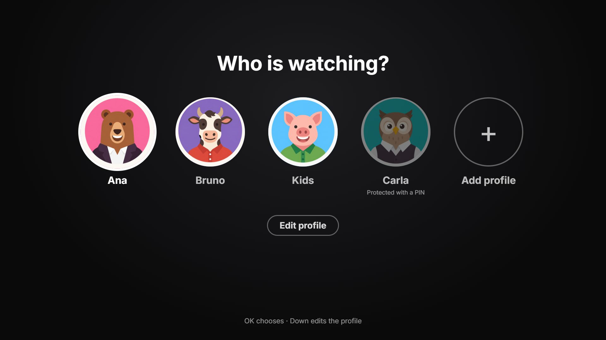
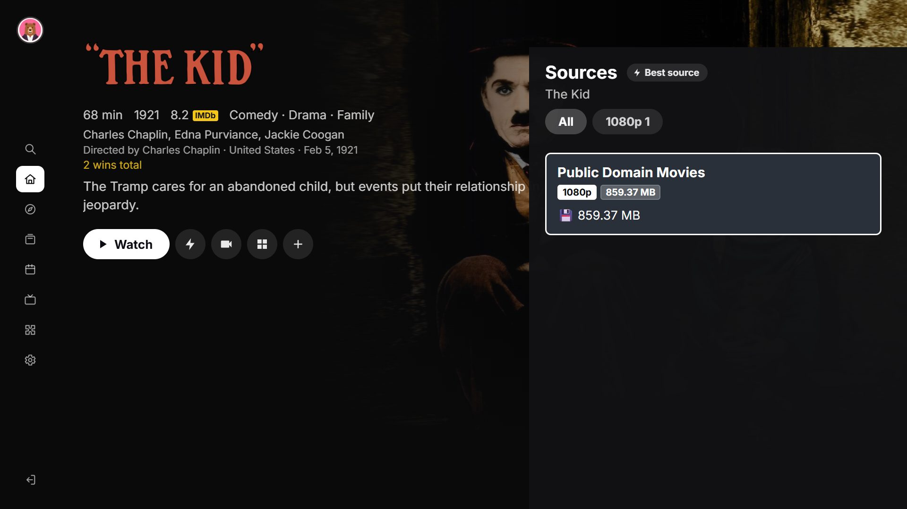
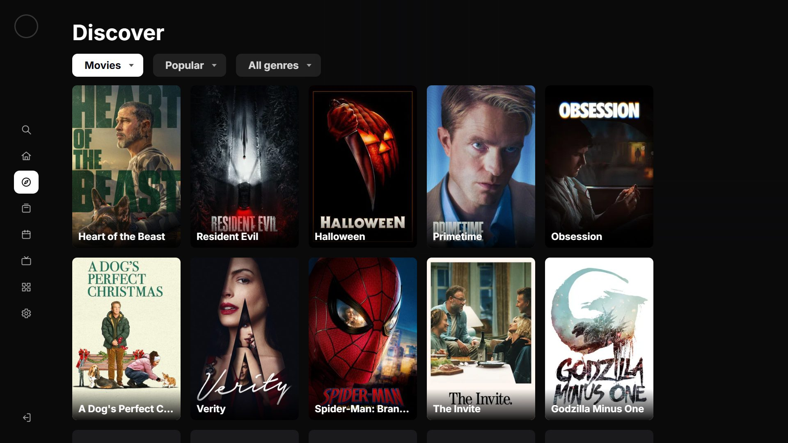
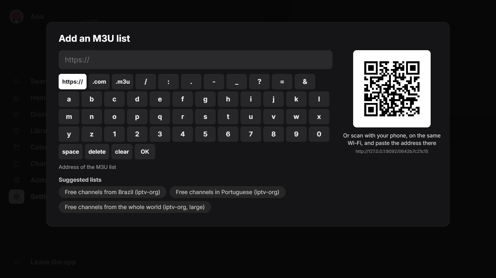
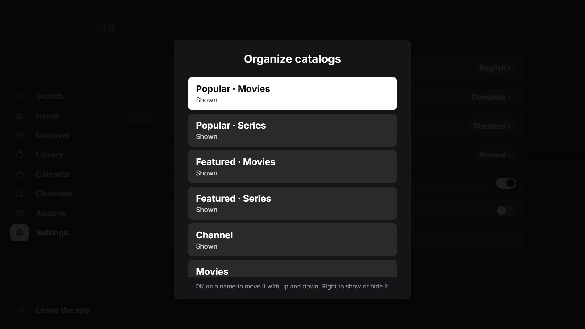
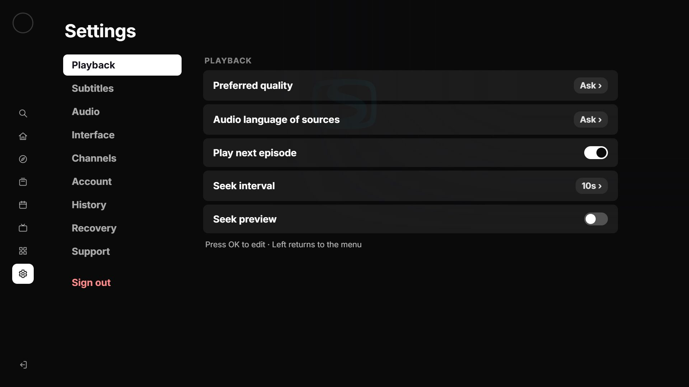

# StremCompat for LG TVs (webOS)

  

  
  
  
  
  
  
  
  

<b>English</b> · <a href="README.pt.md">Português</a>

StremCompat brings your **Stremio or Nuvio** account and addons to LG TVs, including the 2016 to 2019 sets (webOS 3 and 4) where the official apps cannot be installed. It is made for the remote, needs no root and no computer (not even for torrents), and installs and updates from the Homebrew Channel.

It is an independent, unofficial project, not affiliated with or endorsed by Stremio, Nuvio or LG Electronics. It has no content of its own: it plays what your addons provide, so use only addons and sources you are authorized to access.

**Contents:** [Two versions](#two-versions) · [Features](#features) · [Screenshots](#screenshots) · [Installation](#installation) · [First use](#first-use) · [Compatibility](#compatibility) · [How it works](#how-it-works) · [Troubleshooting](#troubleshooting) · [Support](#feedback-and-support) · [Credits](#credits-and-licensing)

## Two versions

| | **StremCompat** | **StremCompat Native** |
|---|---|---|
| Status | **Stable**, recommended | **Beta**, not stable yet: faster, but expect rough edges |
| How it is made | The interface as a web page on the TV's browser engine | Rewritten in C, drawn by the TV's own graphics chip (SDL2, OpenGL ES) |
| Best for | Everyday use | Weaker TVs, and anyone who wants the smoothest scrolling |
| App ID | `io.github.alexesmm.legacytv` | `io.github.alexesmm.stremcompat.native` |
| Updates | Automatic, from the same Homebrew address as always | Its own Homebrew address |

The two are separate apps and can be installed together. Already using StremCompat? Nothing changes: it keeps updating by itself. On its first start, the native version takes your account, library and settings from the web one, so you do not sign in again.

## Features

- **Stremio or Nuvio account:** sign in with a QR code or with email. Library, progress, watched state and addons stay in sync with your other devices.
- **Nuvio profiles:** choose who is watching at every start, open profiles protected by a **PIN**, and add profiles or change their name, colour, avatar and PIN on the TV.
- **Nuvio Collections:** shown as in Nuvio's apps, mixed with your catalogs in the order you set in Nuvio, with poster, square or wide tiles; a folder opens with a tab per catalog (and "All") over a grid.
- **Browsing:** Home, Discover, Search and Library from your addons, with Continue Watching and the minutes left, and new episodes of the series you follow.
- **Calendar** (Stremio accounts): the next episodes of your series, day by day.
- **Live channels:** from addons with TV channels (such as NexoTV, by category) and from **M3U lists**, with what is on now from the list's guide, search, and recent channels. Big IPTV lists of tens of thousands of channels stay fast, and channels are never added to the library.
- **Adding lists and addons without typing on the remote:** scan a QR code with your phone and paste the address there, or use the app's keyboard, or pick one of the suggested free channel lists.
- **Addon store:** community addons in order of popularity, with a picture and the full description; the ones you have are not shown. Or add any addon by its address. Changes go to your account.
- **Organize catalogs:** move and hide the rows of Home.
- **Best source:** one press goes straight to the video, in the quality and audio language you prefer.
- **Source list:** quality and language filters, compatibility warnings, and addons that fail are named.
- **Playback:** direct, debrid, torrent and HLS, on the TV's hardware decoder. Torrents play on the TV itself, or through a streaming server on another computer.
- **Subtitles and audio:** from addons or inside the file, remembered per title, with a backup language, delay, size, colour and position. ASS subtitles can keep their styling.
- **Player:** the season's episodes, chapters, the other files of a torrent, picture size, speed, Skip intro and recap, and the next episode with the same release.
- **Storage:** torrents never fill the TV; with no room they can use a USB drive.
- **Made for the TV:** remote and Magic Remote, colour-button shortcuts, a Simple or Complete mode, a Standard or Light look for weaker TVs, and optional larger text.
- **Eleven languages:** English, Brazilian Portuguese, Spanish (Spain and Latin America), French, German, Italian, Russian, Korean, Japanese and Simplified Chinese.
- **Your control:** Do not save history, Diagnostics (memory, storage, remote response, recent problems) and a connection test.
- **Updates from inside the app.**

## Screenshots

Captured from the real interface at 1920x1080, with a demo account, Stremio's official addons and a public channel list. The interface is the same on LG, Samsung and Android TV.

<table>
  <tr>
    <td width="50%" valign="top"> <b>Home</b> Your catalogs as rows, with the focused title large at the top.</td>
    <td width="50%" valign="top"> <b>Who is watching</b> Nuvio profiles, with PIN-protected ones marked.</td>
  </tr>
  <tr>
    <td width="50%" valign="top"> <b>Series page</b> Details, cast, seasons and episodes with their air dates.</td>
    <td width="50%" valign="top"> <b>Sources</b> Every source your addons find, with quality and size; or Best source in one press.</td>
  </tr>
  <tr>
    <td width="50%" valign="top"> <b>Discover</b> Browse any catalog by type, order and genre.</td>
    <td width="50%" valign="top"> <b>Live channels</b> Categories on the left, channels and what is on now on the right.</td>
  </tr>
  <tr>
    <td width="50%" valign="top"> <b>Adding a list</b> Type the address with the built-in keyboard, scan the QR to paste it from your phone, or pick a suggested list.</td>
    <td width="50%" valign="top"> <b>Addon store</b> Community addons by popularity, with picture and description. The ones you have are hidden.</td>
  </tr>
  <tr>
    <td width="50%" valign="top"> <b>Organize catalogs</b> Reorder or hide the rows of Home.</td>
    <td width="50%" valign="top"> <b>Settings</b> Playback, subtitles, audio, interface, channels and account.</td>
  </tr>
</table>

## Installation

### With the Homebrew Channel (recommended)

1. Install the [Homebrew Channel](https://github.com/webosbrew/webos-homebrew-channel) on the TV.
2. In its settings, add the repository of the version you want:

| Version | Repository address |
|---|---|
| StremCompat, 1080p (Full HD and 4K screens) | `https://stremcompat.github.io/webos/apps.json` |
| StremCompat, 720p (smaller screens such as 1366x768; also lighter) | `https://stremcompat.github.io/webos/720/apps.json` |
| StremCompat Native (adapts to the screen) | `https://stremcompat.github.io/webos/native/apps.json` |

3. Install it from the channel. The app tells you when a new version is out.

The addresses used before, `alexesmm.github.io/stremcompat-lg-webos/apps.json` and `.../720/apps.json`, keep working.

### With Developer Mode

1. Install LG's **Developer Mode** app on the TV, sign in, and enable Developer Mode and Key Server.
2. Add the TV in **webOS Dev Manager**.
3. Download the package from [Releases](https://github.com/StremCompat/webos/releases) and install it:
   - `StremCompat-v…-1080p.ipk` or `StremCompat-v…-720p.ipk` for the web version;
   - `StremCompat-Native-v….ipk` for the native one.

Developer Mode installations expire with its timer, so renew it before it reaches zero.

The web version uses about 13 MB once installed, plus up to 768 MB of free storage while a torrent plays, cleared when it stops.

> **Coming from 2.x?** If you used `StremCompat`, this updates it. If you used `StremCompat HD`, `StremCompat UJ3` or `StremCompat UJ3 HD`, remove that app and install the package for your screen: it replaces all of them.

## First use

StremCompat has no accounts or sources of its own.

1. Create a free account at [stremio.com/register](https://www.stremio.com/register) or [nuvio.tv](https://nuvio.tv), if you do not have one.
2. Install addons in the Stremio or Nuvio app or website, or later from the app's own store. Without an addon that provides sources, titles open but have nothing to play.
3. On the TV, choose **Stremio** or **Nuvio** and sign in with the QR code or with your email and password.

## Compatibility

StremCompat targets LG TVs with an ARM processor, from **webOS 3** on, roughly the 2016 models and newer.

| webOS | Typical years | Example families |
|---|---|---|
| 3.0 / 3.5 | 2016-2017 | OLED B6/C6/E6/G6, B7/C7/E7/G7/W7; LCD UH6x-UH9x, SJ8x-SJ9x, UJ6x-UJ7x, LJ5x |
| 4.0 / 4.5 | 2018-2019 | OLED B8/C8/E8/W8/Z8, B9/C9/E9/W9/Z9; LCD SK8x-SK9x, UK6x-UK7x, SM8x-SM9x, UM69-UM80, LK5x-LK6x, LM5x-LM6x |
| 5 and newer | 2020 onwards | Works; the official Stremio app may also be available on these |

webOS 1.x and 2.x are not supported.

### Tested televisions

| Television | webOS / firmware | Result | Source |
|---|---|---|---|
| LG 50UM7500PSB | 4.5 | Working; native version in beta | Maintainer |
| LG 49UJ6565-SB | 3.9.3 | Working | Maintainer |
| LG 43LH600T | 3.4.3 / 05.70.50 | Working (720p); Magic Remote not tested | User report |
| LG UJ6300 | Not stated | Working so far | User report |
| LG OLED C9 | Not stated | Working | User report |
| Not stated | 4.5 | Working | User report |
| Not stated | 7.0.0 / 4.60.90 | Working | User report |

Tried it on another TV? [Send a compatibility report](https://github.com/StremCompat/webos/issues/new).

## How it works

A small launcher starts a local server on the TV's own Node.js. Addon requests, accounts, subtitles and the video proxy go through it, which avoids the old browser's TLS and CORS limits, and video uses the TV's hardware decoder. The web version draws its interface as a page; the native version draws it in C through SDL2 and OpenGL ES, and talks to the same server.

FFmpeg (artwork, seek previews and subtitles inside the video) and a torrent engine over [Nuvio Engine](https://github.com/NuvioMedia/nuvio-engine) and libtorrent come with it, built from source. The source code is in [StremCompat/stremcompat](https://github.com/StremCompat/stremcompat) and [StremCompat/native](https://github.com/StremCompat/native).

## Troubleshooting

- **Interface cut off or only on part of the screen:** use the 720p repository. Remove the repository you added in the Homebrew Channel and add the 720p one. If it still shows the old version, uninstall the app first.
- **"Can't reach Stremio", or nothing loads while other apps work:** the network probably hands out IPv6 without a working connection. Turn IPv6 off on the TV (Settings > Network > connection > Advanced settings) or on the router.
- **Stuck on the loading screen after an update (`RUNTIME_START_TIMEOUT`):** unplug the TV for at least 30 seconds and open it again. The remote is not enough when Quick Start+ is on. Your account and settings stay.
- **The native version closes or will not start:** it shows the reason on screen or in a notification. Send a photo of it in [Discussions](https://github.com/StremCompat/webos/discussions) and use the web version meanwhile.
- **Torrents do not start, but debrid and direct links work:** Settings > Diagnostics shows the state of the engine. Few seeders or little free storage can also keep a torrent from starting.
- **A source appears but does not play:** usually a codec, bitrate or addon issue. Try a moderate H.264/AAC source first.
- **The QR code to paste an address from the phone does not open:** the phone must be on the same Wi-Fi, and some routers keep devices apart. Type the address with the app's keyboard instead.

## Moving between Stremio and Nuvio

To copy addons, library and progress between a Stremio and a Nuvio account, see the companion tool [nuvio-to-stremio](https://github.com/Alexesmm/nuvio-to-stremio), online at [addons-sync.vercel.app](https://addons-sync.vercel.app/).

## Other TVs and the project

StremCompat lives in the [StremCompat organization](https://github.com/StremCompat):

- **LG** (webOS 3 and newer): [StremCompat/webos](https://github.com/StremCompat/webos) (this page)
- **Samsung** (Tizen 4 and newer): [StremCompat/samsung](https://github.com/StremCompat/samsung)
- **Android TV / Google TV** (7.0 and newer): [StremCompat/android-tv](https://github.com/StremCompat/android-tv)
- Source code: [StremCompat/stremcompat](https://github.com/StremCompat/stremcompat) (web version and local server) and [StremCompat/native](https://github.com/StremCompat/native) (native version).

This page used to be `Alexesmm/stremcompat-lg-webos`. Old links lead here, and the old Homebrew addresses keep working and updating, with your account and library in place.

## Feedback and support

Use [Discussions](https://github.com/StremCompat/webos/discussions) for questions, ideas and compatibility results, and [Issues](https://github.com/StremCompat/webos/issues) for reproducible bugs. Never post passwords, tokens or an active pairing QR code.

StremCompat is free and made in my spare time. If it has been useful to you, you can [buy me a coffee ☕](https://buymeacoffee.com/Alexesmm), which is entirely optional.

## Credits and licensing

- **[StremioBrew](https://github.com/simussu9-wq/stremiobrew)**: StremCompat started from its 1.0.0 package and has since been rewritten.
- **[kieranbrown/stremio-webos](https://github.com/kieranbrown/stremio-webos)**: StremCompat started as a fork of this project, whose earlier interface came from [NoobyGains/stremio-vidaa-tv](https://github.com/NoobyGains/stremio-vidaa-tv). The launcher and interface have since been rewritten; the native version is new code.
- [Nuvio Engine](https://github.com/NuvioMedia/nuvio-engine) and libtorrent power the torrent engine. FFmpeg, SDL2, the Inter typeface and LG webOS tooling are also used. Stremio and Nuvio are trademarks of their owners.

StremCompat is licensed under [GPL-3.0](LICENSE). The license does not cover other third-party components or the names and logos of StremCompat, Stremio, Nuvio and LG.
