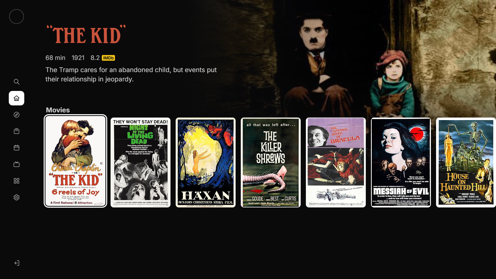
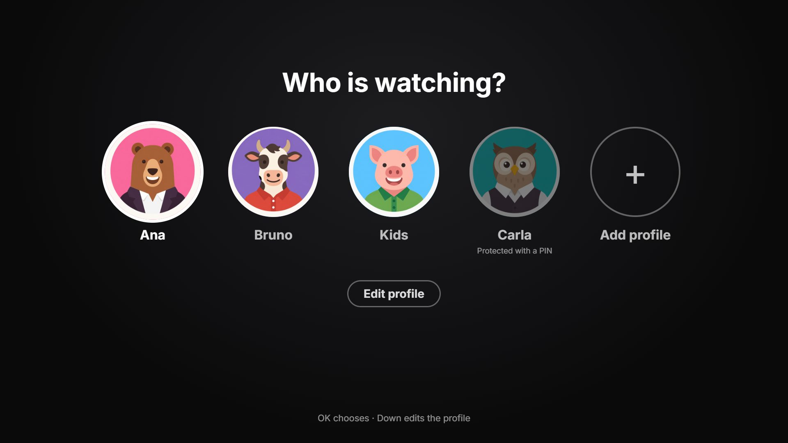
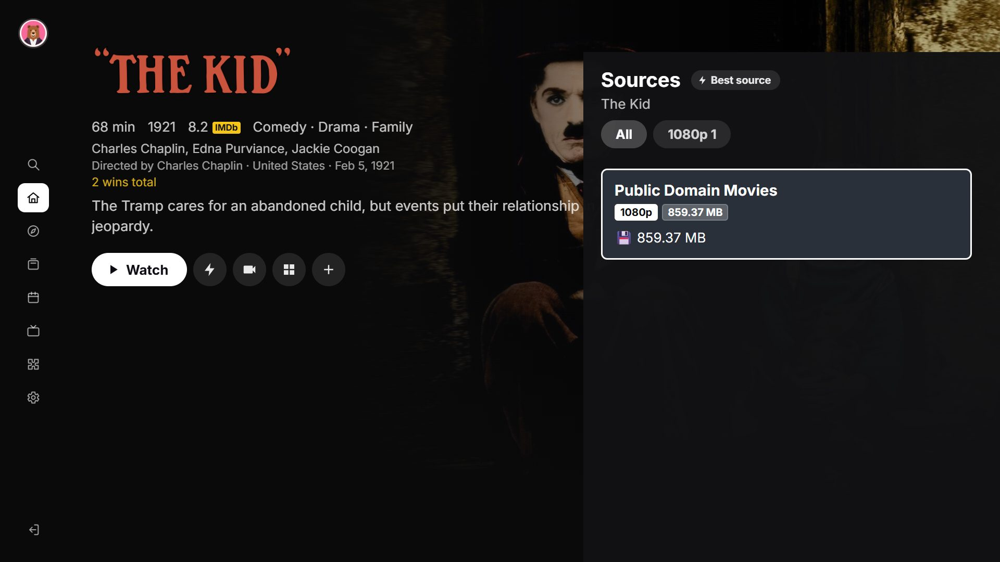
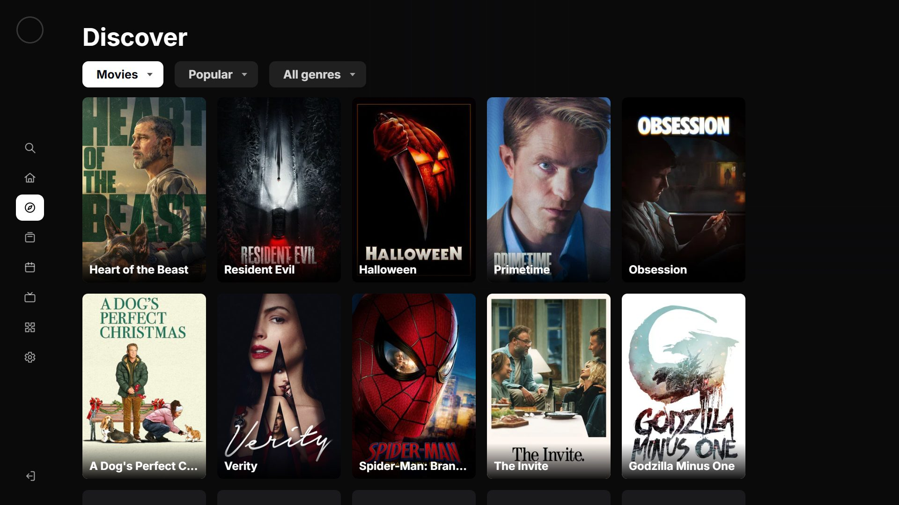
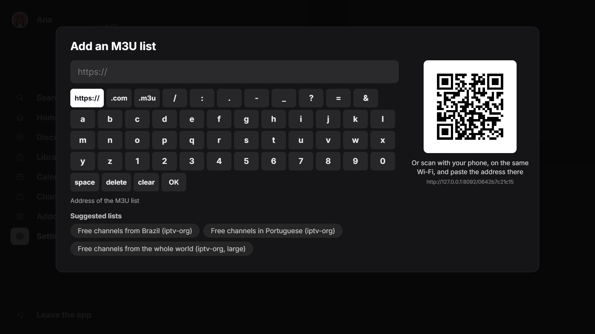
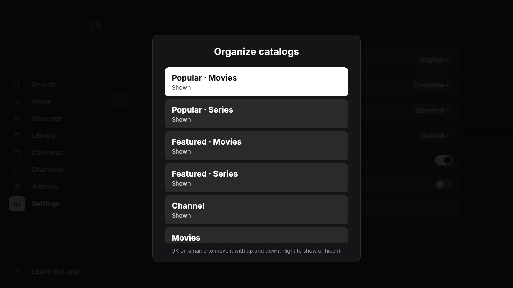
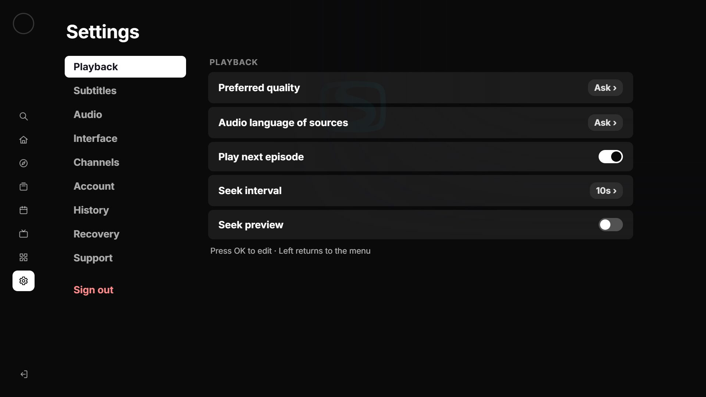

# StremCompat para TVs LG (webOS)

  

  
  
  
  
  
  

<a href="README.md">English</a> · <b>Português</b>

O StremCompat leva sua conta e seus addons do **Stremio ou do Nuvio** para TVs LG, inclusive os modelos de 2016 a 2019 (webOS 3 e 4), onde os apps oficiais não podem ser instalados. Foi feito para o controle remoto, não precisa de root nem de computador (nem para torrents) e é instalado e atualizado pelo Homebrew Channel.

É um projeto independente e não oficial, sem ligação com o Stremio, o Nuvio ou a LG Electronics. Ele não tem conteúdo próprio: toca o que os seus addons oferecem, então use apenas addons e fontes que você tem direito de acessar.

**Conteúdo:** [Duas versões](#duas-versões) · [Recursos](#recursos) · [Capturas](#capturas-de-tela) · [Instalação](#instalação) · [Primeiro uso](#primeiro-uso) · [Compatibilidade](#compatibilidade) · [Como funciona](#como-funciona) · [Problemas comuns](#problemas-comuns) · [Suporte](#dúvidas-e-suporte) · [Créditos](#créditos-e-licença)

## Duas versões

| | **StremCompat** | **StremCompat Native** |
|---|---|---|
| Situação | **Estável**, recomendada | **Beta**, ainda não estável: mais rápida, mas pode ter falhas |
| Como é feita | A interface como página, no navegador da TV | Reescrita em C, desenhada pela placa gráfica da própria TV (SDL2, OpenGL ES) |
| Indicada para | Uso no dia a dia | TVs mais fracas e quem quer a rolagem mais suave |
| ID do app | `io.github.alexesmm.legacytv` | `io.github.alexesmm.stremcompat.native` |
| Atualizações | Automáticas, pelo mesmo endereço do Homebrew de sempre | Endereço próprio no Homebrew |

As duas são apps separados e podem ser instaladas juntas. Já usa o StremCompat? Nada muda: ele continua se atualizando sozinho. Na primeira vez que abre, a versão Native pega sua conta, biblioteca e ajustes da versão web, então você não precisa entrar de novo.

## Recursos

- **Conta Stremio ou Nuvio:** entre com QR code ou e-mail. Biblioteca, progresso, assistidos e addons ficam sincronizados com seus outros aparelhos.
- **Perfis do Nuvio:** escolha quem está assistindo a cada abertura, abra perfis protegidos por **PIN** e crie perfis ou mude nome, cor, avatar e PIN pela TV.
- **Coleções do Nuvio:** mostradas como nos apps do Nuvio, misturadas aos catálogos na ordem definida no Nuvio, com capas em pôster, quadrado ou largo; uma pasta abre com uma aba por catálogo (e "Todos") sobre uma grade.
- **Navegação:** Início, Descobrir, Busca e Biblioteca a partir dos seus addons, com Continuar assistindo e os minutos que faltam, e os episódios novos e próximos das séries que você acompanha.
- **Calendário** (contas Stremio): os próximos episódios das suas séries, dia a dia.
- **Canais ao vivo:** de addons com canais de TV (como o NexoTV, por categoria) e de **listas M3U**, com a programação atual do guia, busca e canais recentes. Listas grandes, com dezenas de milhares de canais, continuam rápidas, e canais nunca vão para a biblioteca.
- **Adicionar listas e addons sem digitar no controle:** escaneie um QR code com o celular e cole o endereço por lá, use o teclado do app ou escolha uma das listas gratuitas sugeridas.
- **Loja de addons:** addons da comunidade por popularidade, com imagem e descrição completa; os que você já tem não aparecem. Ou adicione qualquer addon pelo endereço. As mudanças vão para a sua conta.
- **Organizar catálogos:** mova e esconda as fileiras do Início.
- **Melhor fonte:** um botão leva direto ao vídeo, na qualidade e no idioma de áudio que você prefere.
- **Lista de fontes:** debrid em cache primeiro, filtros de qualidade, idioma, HDR, Atmos e Remux, avisos de compatibilidade, e os addons que falharam aparecem com nome.
- **Reprodução:** links diretos, debrid, torrent e HLS, no decodificador de hardware da TV. Torrents tocam na própria TV ou por um servidor de streaming em outro computador.
- **Legendas e áudio:** de addons ou de dentro do arquivo, lembrados por série, com idioma reserva, atraso, tamanho, cor e posição. Legendas ASS podem manter o estilo.
- **Player:** episódios da temporada, capítulos, os outros arquivos de um torrent, tamanho da imagem, velocidade, pular abertura e recapitulação, e o próximo episódio com a mesma versão.
- **Armazenamento:** torrents nunca enchem a TV; sem espaço, podem usar um pendrive.
- **Feito para a TV:** controle remoto e Magic Remote, atalhos nos botões coloridos, modo Simples ou Completo, visual Padrão ou Leve para TVs mais fracas e texto maior opcional.
- **Otimizado para TVs antigas:** só as imagens perto do foco ficam na memória, as capas são reduzidas pela própria TV, há um modo para pouca RAM e um pacote 720p para telas HD.
- **Onze idiomas:** inglês, português do Brasil, espanhol (Espanha e América Latina), francês, alemão, italiano, russo, coreano, japonês e chinês simplificado.
- **Você no controle:** Não salvar histórico, Diagnóstico (memória, armazenamento, resposta do controle, problemas recentes) e teste de conexão.
- **Atualizações de dentro do app.**

## Capturas de tela

Capturadas da interface real em 1920x1080, com uma conta de demonstração, os addons oficiais do Stremio e uma lista pública de canais. A interface é a mesma na LG, na Samsung e no Android TV.

<table>
  <tr>
    <td width="50%" valign="top"> <b>Início</b> Seus catálogos em fileiras, com o título em foco em destaque no topo.</td>
    <td width="50%" valign="top"> <b>Quem está assistindo</b> Perfis do Nuvio, com os protegidos por PIN marcados.</td>
  </tr>
  <tr>
    <td width="50%" valign="top"> <b>Página da série</b> Detalhes, elenco, temporadas e episódios com datas de estreia.</td>
    <td width="50%" valign="top"> <b>Fontes</b> Todas as fontes que seus addons encontram, com qualidade e tamanho; ou a Melhor fonte num botão.</td>
  </tr>
  <tr>
    <td width="50%" valign="top"> <b>Descobrir</b> Navegue por qualquer catálogo por tipo, ordem e gênero.</td>
    <td width="50%" valign="top"> <b>Canais ao vivo</b> Categorias à esquerda, canais e programação atual à direita.</td>
  </tr>
  <tr>
    <td width="50%" valign="top"> <b>Adicionar uma lista</b> Digite o endereço no teclado do app, escaneie o QR para colar pelo celular ou escolha uma lista sugerida.</td>
    <td width="50%" valign="top"> <b>Loja de addons</b> Addons da comunidade por popularidade, com imagem e descrição. Os que você já tem ficam escondidos.</td>
  </tr>
  <tr>
    <td width="50%" valign="top"> <b>Organizar catálogos</b> Reordene ou esconda as fileiras do Início.</td>
    <td width="50%" valign="top"> <b>Ajustes</b> Reprodução, legendas, áudio, interface, canais e conta.</td>
  </tr>
</table>

## Instalação

### Pelo Homebrew Channel (recomendado)

1. Instale o [Homebrew Channel](https://github.com/webosbrew/webos-homebrew-channel) na TV.
2. Nos ajustes dele, adicione o repositório da versão que você quer:

| Versão | Endereço do repositório |
|---|---|
| StremCompat, 1080p (telas Full HD e 4K) | `https://stremcompat.github.io/webos/apps.json` |
| StremCompat, 720p (telas menores, como 1366x768; também mais leve) | `https://stremcompat.github.io/webos/720/apps.json` |
| StremCompat Native (se adapta à tela) | `https://stremcompat.github.io/webos/native/apps.json` |

3. Instale pelo canal. O app avisa quando sai uma versão nova.

Os endereços antigos, `alexesmm.github.io/stremcompat-lg-webos/apps.json` e `.../720/apps.json`, continuam funcionando.

### Pelo Modo Desenvolvedor

1. Instale o app **Developer Mode** da LG na TV, entre na conta e ative o Developer Mode e o Key Server.
2. Adicione a TV no **webOS Dev Manager**.
3. Baixe o pacote em [Releases](https://github.com/StremCompat/webos/releases) e instale:
   - `StremCompat-v…-1080p.ipk` ou `StremCompat-v…-720p.ipk` para a versão web;
   - `StremCompat-Native-v….ipk` para a Native.

Instalações pelo Modo Desenvolvedor expiram junto com o contador dele, então renove antes de chegar a zero.

A versão web ocupa cerca de 13 MB instalada, e até 768 MB de espaço livre enquanto um torrent toca, liberados quando ele para.

> **Vindo da 2.x?** Se você usava o `StremCompat`, isto o atualiza. Se usava o `StremCompat HD`, `StremCompat UJ3` ou `StremCompat UJ3 HD`, remova esse app e instale o pacote para a sua tela: ele substitui todos.

## Primeiro uso

O StremCompat não tem contas nem fontes próprias.

1. Crie uma conta gratuita em [stremio.com/register](https://www.stremio.com/register) ou [nuvio.tv](https://nuvio.tv), se ainda não tiver.
2. Instale addons no app ou site do Stremio ou do Nuvio, ou depois pela loja do próprio app. Sem um addon que ofereça fontes, os títulos abrem mas não têm o que tocar.
3. Na TV, escolha **Stremio** ou **Nuvio** e entre com o QR code ou com e-mail e senha.

## Compatibilidade

O StremCompat é para TVs LG com processador ARM, a partir do **webOS 3**, mais ou menos os modelos de 2016 em diante.

| webOS | Anos típicos | Exemplos de linhas |
|---|---|---|
| 3.0 / 3.5 | 2016-2017 | OLED B6/C6/E6/G6, B7/C7/E7/G7/W7; LCD UH6x-UH9x, SJ8x-SJ9x, UJ6x-UJ7x, LJ5x |
| 4.0 / 4.5 | 2018-2019 | OLED B8/C8/E8/W8/Z8, B9/C9/E9/W9/Z9; LCD SK8x-SK9x, UK6x-UK7x, SM8x-SM9x, UM69-UM80, LK5x-LK6x, LM5x-LM6x |
| 5 ou mais novo | 2020 em diante | Funciona; o app oficial do Stremio também pode estar disponível nelas |

webOS 1.x e 2.x não são suportados.

**Recomendadas e testadas:** LG com webOS 3.x e 4.x, como OLED B7, OLED E8, OLED C9, UM7100, UM7500 e UJ6300.

Testou em outra TV? [Envie um relato de compatibilidade](https://github.com/StremCompat/webos/issues/new).

## Como funciona

Um pequeno inicializador liga um servidor local no Node.js da própria TV. Pedidos aos addons, contas, legendas e o proxy de vídeo passam por ele, o que contorna os limites de TLS e CORS do navegador antigo, e o vídeo usa o decodificador de hardware da TV. A versão web desenha a interface como página; a Native desenha em C, pelo SDL2 e OpenGL ES, e conversa com o mesmo servidor.

O FFmpeg (capas, prévias ao avançar e legendas de dentro do vídeo) e um motor de torrent sobre o [Nuvio Engine](https://github.com/NuvioMedia/nuvio-engine) e o libtorrent vêm junto, compilados a partir do código-fonte. O código está em [StremCompat/stremcompat](https://github.com/StremCompat/stremcompat) e [StremCompat/native](https://github.com/StremCompat/native).

## Problemas comuns

- **Interface cortada ou ocupando só parte da tela:** use o repositório 720p. Remova o repositório que você adicionou no Homebrew Channel e adicione o 720p. Se ainda aparecer a versão antiga, desinstale o app antes.
- **"Não foi possível acessar o Stremio", ou nada carrega enquanto outros apps funcionam:** provavelmente a rede entrega IPv6 sem conexão funcionando. Desative o IPv6 na TV (Ajustes > Rede > conexão > Configurações avançadas) ou no roteador.
- **Preso na tela de carregamento depois de uma atualização (`RUNTIME_START_TIMEOUT`):** tire a TV da tomada por pelo menos 30 segundos e abra de novo. O controle não basta quando o Quick Start+ está ligado. Sua conta e ajustes ficam.
- **A versão Native fecha ou não abre:** ela mostra o motivo na tela ou numa notificação. Mande uma foto em [Discussions](https://github.com/StremCompat/webos/discussions) e use a versão web enquanto isso.
- **Torrents não começam, mas debrid e links diretos funcionam:** Ajustes > Diagnóstico mostra o estado do motor. Poucos seeders ou pouco espaço livre também podem impedir um torrent de começar.
- **Uma fonte aparece mas não toca:** geralmente é codec, taxa de bits ou o addon. Tente primeiro uma fonte H.264/AAC moderada.
- **O QR code para colar um endereço pelo celular não abre:** o celular precisa estar no mesmo Wi-Fi, e alguns roteadores isolam os aparelhos. Digite o endereço no teclado do app.

## Entre o Stremio e o Nuvio

Para copiar addons, biblioteca e progresso entre uma conta Stremio e uma Nuvio, veja a ferramenta [nuvio-to-stremio](https://github.com/Alexesmm/nuvio-to-stremio), online em [addons-sync.vercel.app](https://addons-sync.vercel.app/).

## Outras TVs e o projeto

O StremCompat fica na [organização StremCompat](https://github.com/StremCompat):

- **LG** (webOS 3 ou mais novo): [StremCompat/webos](https://github.com/StremCompat/webos) (esta página)
- **Samsung** (Tizen 4 ou mais novo): [StremCompat/samsung](https://github.com/StremCompat/samsung)
- **Android TV / Google TV** (7.0 ou mais novo): [StremCompat/android-tv](https://github.com/StremCompat/android-tv)
- Código-fonte: [StremCompat/stremcompat](https://github.com/StremCompat/stremcompat) (versão web e servidor local) e [StremCompat/native](https://github.com/StremCompat/native) (versão Native). O que mudou em cada versão está no [CHANGELOG](https://github.com/StremCompat/stremcompat/blob/main/CHANGELOG.md).

Esta página antes era `Alexesmm/stremcompat-lg-webos`. Os links antigos levam para cá, e os endereços antigos do Homebrew continuam funcionando e atualizando, com sua conta e biblioteca no lugar.

## Dúvidas e suporte

Use [Discussions](https://github.com/StremCompat/webos/discussions) para dúvidas, ideias e resultados de compatibilidade, e [Issues](https://github.com/StremCompat/webos/issues) para bugs que dá para reproduzir. Nunca publique senhas, tokens ou um QR de pareamento ativo.

O StremCompat é gratuito e feito no meu tempo livre. Se ele foi útil para você, você pode me [pagar um café ☕](https://buymeacoffee.com/Alexesmm), totalmente opcional. Uma estrela no GitHub também ajuda outras pessoas a encontrar o projeto.

## Créditos e licença

- **[StremioBrew](https://github.com/simussu9-wq/stremiobrew)**: o StremCompat começou a partir do pacote 1.0.0 dele e desde então foi reescrito.
- **[kieranbrown/stremio-webos](https://github.com/kieranbrown/stremio-webos)**: o StremCompat começou como fork deste projeto, cuja interface anterior veio do [NoobyGains/stremio-vidaa-tv](https://github.com/NoobyGains/stremio-vidaa-tv). O inicializador e a interface foram reescritos; a versão Native é código novo.
- O [Nuvio Engine](https://github.com/NuvioMedia/nuvio-engine) e o libtorrent movem o motor de torrent. Também são usados o FFmpeg, o SDL2, a fonte Inter e as ferramentas da LG para webOS. Stremio e Nuvio são marcas de seus donos.

O StremCompat é licenciado sob a [GPL-3.0](LICENSE). A licença não cobre outros componentes de terceiros nem os nomes e logos do StremCompat, do Stremio, do Nuvio e da LG.
